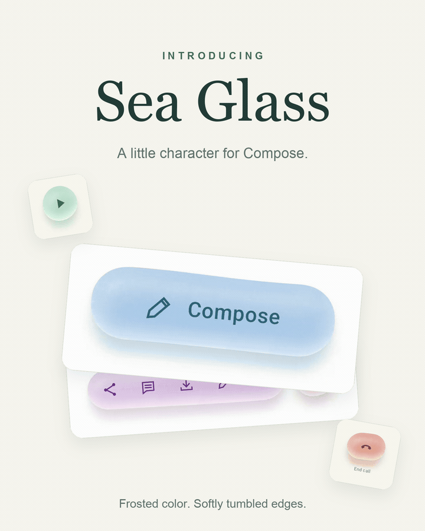
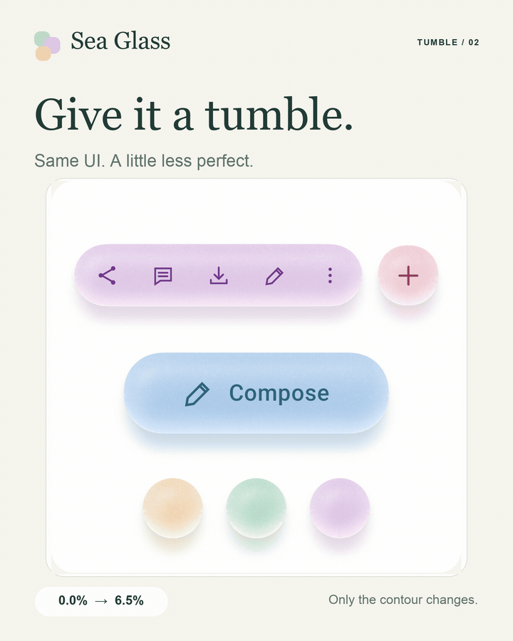
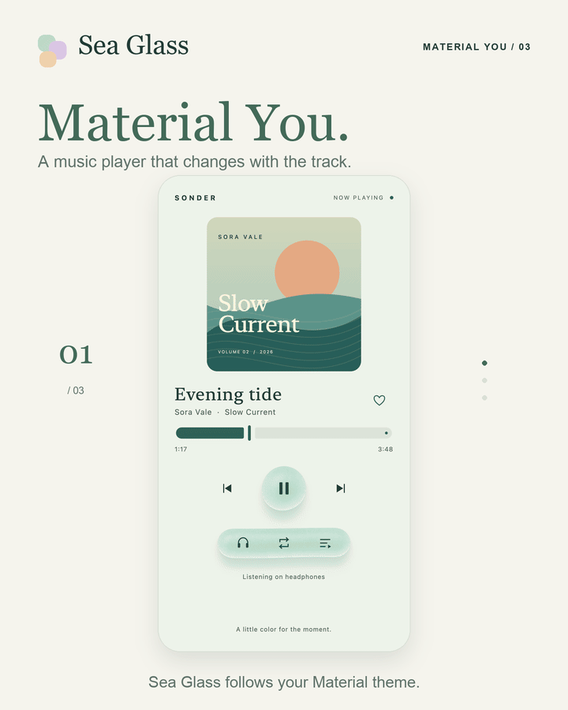
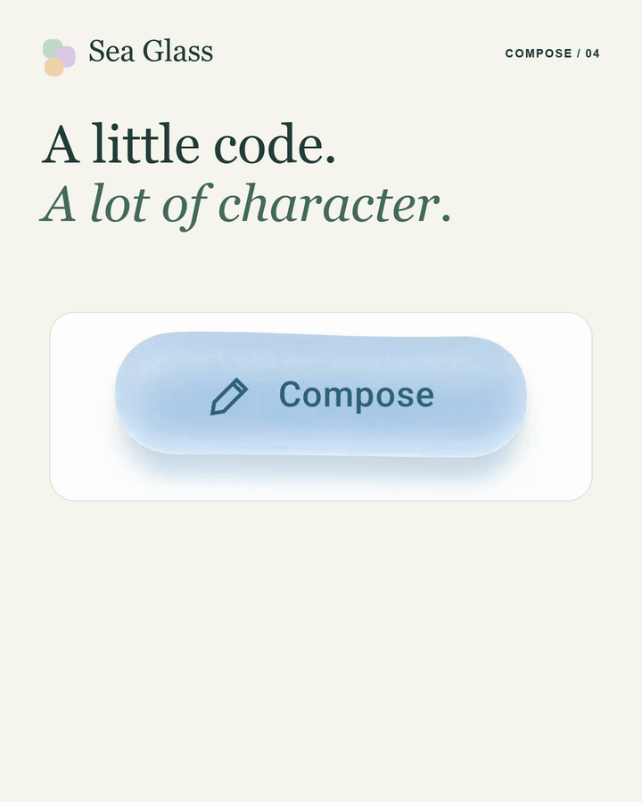
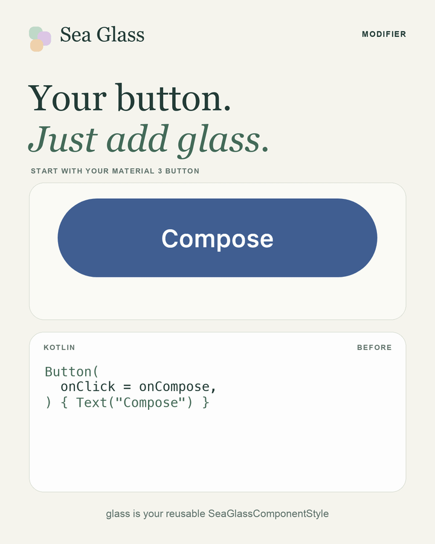

# Sea Glass

Frosted, softly tumbled glass for Jetpack Compose and Compose Multiplatform. The library ports the approved [web playground](https://sea-glass-playground.mttmcknn.chatgpt.site): seeded outlines, microscopic frost, a curved colored interior, a luminous lower edge, and soft transmitted light beneath each piece.

<p align="center">
  
</p>

```kotlin
SeaGlassButton(
    onClick = { composeMessage() },
    palette = SeaGlassPalette.Lagoon,
    style = SeaGlassStyle.Reference.copy(seed = 33),
) {
    Text("Compose")
}
```

Use `SeaGlassSurface` for containers or `Modifier.seaGlass()` behind your existing controls. Text, icons, semantics, and click handling stay native Compose content. Android 13+ and Skia draw the complete material on the first frame. Lighting and color changes apply immediately; rapid shape edits are coalesced in the background while the last complete shape stays visible. The final requested shape is retained. Older Android versions use a cached asynchronous CPU fallback.

Set app-wide defaults with a theme, then override only what a particular piece needs:

```kotlin
SeaGlassTheme(style = SeaGlassStyle.Tumbled, palette = SeaGlassPalette.Mint) {
    SeaGlassButton(onClick = { composeMessage() }) { Text("Compose") }
    SeaGlassTheme(palette = SeaGlassPalette.Rose) {
        SeaGlassButton(onClick = { addMoment() }) { Text("Add") }
    }
}
```

Use Material You through your existing Material 3 theme:

```kotlin
MaterialTheme(colorScheme = rememberSeaGlassColorScheme()) { // Android
    SeaGlassMaterialTheme {
        SeaGlassButton(onClick = { composeMessage() }) { Text("Compose") }
    }
}
```

`rememberSeaGlassColorScheme()` reads wallpaper colors on Android 12+ and falls back to light/dark Material schemes on older Android. `SeaGlassMaterialTheme` also works on desktop and iOS with any host-provided Material 3 scheme. Use `SeaGlassPalette.materialTheme(SeaGlassColorRole.Secondary)` for an individual component. See [Material You usage](docs/usage.md#material-you-and-material-3-colors) for roles and custom fallbacks.

`SeaGlassComponentStyle` bundles a recipe, palette, and shape into a reusable design-system value. Pass it to the theme, components, or modifier. [Themes and styles](docs/usage.md#themes) cover inheritance, per-piece seeds, and explicit overrides.

## Demos

Five short loops cover the components, Tumble, Material You, and Compose integration. [Capture notes](assets/demos/README.md) describe the sources and scope.

<details>
<summary>Explore all five demos</summary>

<table>
  <tr>
    <td width="50%" valign="top">
      <h3>Introducing Sea Glass</h3>
      
      <p>Frosted color, softly tumbled edges, and transmitted light across components and local sample interfaces.</p>
    </td>
    <td width="50%" valign="top">
      <h3>Give it a Tumble</h3>
      
      <p>Compare precise and uneven contours while layout, color, frost, content, and seed stay fixed.</p>
    </td>
  </tr>
  <tr>
    <td width="50%" valign="top">
      <h3>Material You music example</h3>
      
      <p>This standalone Compose demo supplies curated album-inspired Material 3 schemes. The background, text, progress bar, and <code>SeaGlassMaterialTheme</code> controls follow each track.</p>
    </td>
    <td width="50%" valign="top">
      <h3>A little Compose code</h3>
      
      <p><code>SeaGlassButton</code> takes your click handler and composable content. The snippet is a minimal usage example; the pictured sample adds an icon and styling.</p>
    </td>
  </tr>
  <tr>
    <td colspan="2" align="center" valign="top">
      <h3>Add glass to your Material button</h3>
      
      <p>Start with the same Material 3 Button. The modifier, transparent fill, and palette text color are typed into its code before the button changes to glass. The callback and content stay in place.</p>
    </td>
  </tr>
</table>

</details>

## Project

| Directory | Purpose |
| --- | --- |
| `sea-glass/` | Shared Kotlin material engine and Compose components; Android, iOS, and desktop targets |
| `sample/` | Shared Compose playground with recipes, palettes, sliders, and working sample controls |
| `androidApp/` | Android sample host |
| `desktopApp/` | Desktop sample host |
| `web/` | The exact approved HTML/CSS/JavaScript playground and its original tests |
| `tools/` | Reproducible web reference generation for Kotlin parity tests |

## Run

Use JDK 17. Android builds also require SDK 36 and Build Tools 36.0.0. Set `sdk.dir` in an untracked `local.properties`, or set `ANDROID_HOME`.

```sh
./gradlew :desktopApp:run
./gradlew :androidApp:assembleDebug
./gradlew :sea-glass:jvmTest
```

Without an Android SDK, pass `-PseaGlass.android=false` for desktop work:

```sh
./gradlew -PseaGlass.android=false :desktopApp:run
```

The Compose playground uses a live two-pane layout from 600 dp of available window width: components on the left, independently scrolling controls on the right. Narrower windows stack the sections. It adapts when resizing, rotating, or folding, preserves the current recipe and selections, and respects system-bar insets.

Choose **Music player**, **Phone call**, **Email**, or **AI chat** from the scene dropdown to try the material in familiar interfaces. The same sliders change their glass accents live. **Mix** gives each scene its own palette; choosing a color changes its main glass accents. These are interactive local mockups with sample content.

The **Material You** switch above the scene selector applies Material colors to the glass accents across the examples; the active hang-up button retains its semantic coral color. Android 12+ uses wallpaper colors; other hosts use the fallback Material scheme. The sample has a light canvas and requests a light scheme. Turning the switch off restores the selected SeaGlass palette; choosing a palette or Reset exits Material You. The selection survives rotation and layout changes.

For screenshots, tap **Preview only** to hide the playground controls while preserving the selected palette, note state and working scene actions. Double-tap the background, press **Escape**, or use the **Show controls** accessibility action to return. Keyboard focus returns to the Preview only button. Palette choices expose their selected state to accessibility services. [Preview the four app interfaces](docs/screenshots/app-interfaces.png).

Check slider updates, independent scrolling, and the resize boundary with:

```sh
./gradlew -PseaGlass.android=false :desktopApp:verifyPlayground
```

For an installable, non-debuggable performance build, run `./gradlew :androidApp:assembleDemoRelease`. It uses R8 optimization and resource shrinking, signed with the sample debug key so local demo builds can update each other. Store-distributed apps need their own release signing configuration.

The [rendering guide](docs/rendering.md) explains the live shader, its visual differences from the original CPU renderer, and the Android compatibility path. The [performance report](docs/performance/README.md) retains the CPU hill-climb measurements; its 336 exact pixel checks apply to the reference CPU implementation, not the default live shader.

The web demo is buildless:

```sh
cd web
npm test
python3 -m http.server 8000 --directory dist
```

## Use in an app

The current version is `0.1.0-SNAPSHOT`. Maven Central publishing is configured, but artifact availability has not been verified. To use the library from a checkout, include it as a composite build:

```kotlin
// settings.gradle.kts in your application
includeBuild("../sea-glass") {
    dependencySubstitution {
        substitute(module("dev.mttmcknn:sea-glass")).using(project(":sea-glass"))
    }
}
```

```kotlin
// Android dependencies, or commonMain.dependencies in a KMP app
implementation("dev.mttmcknn:sea-glass:0.1.0-SNAPSHOT")
```

See [the usage guide](docs/usage.md) for styles, containers, custom controls, clipping, and rendering costs. [Rendering notes](docs/rendering.md) explain how the port matches the web source and where platform rasterization can differ.

The [native Compose screenshot gallery](docs/rendering.md#native-compose-screenshots) shows the playground, component specimens, tumble/bulge combinations, and material recipes. Regenerate it with `./gradlew -PseaGlass.android=false :desktopApp:captureScreenshots`.

The build pins Kotlin 2.3.21, Compose Multiplatform 1.10.3, AGP 9.0.0, and Gradle 9.1.0. Android uses the dedicated Kotlin Multiplatform Android library plugin. iOS targets require Xcode on macOS.

## Publishing

[Maven publishing](docs/publishing.md) covers local artifact verification, Central namespace and signing setup, and the manual release process. The library targets Android, desktop/JVM, iOS devices, and Apple Silicon iOS simulators. The repository uses the [Apache License 2.0](LICENSE).

## Validation

The Kotlin/Compose suite covers the CPU reference, shader inputs and body quality, ground blur, themes, Material color roles, cache transitions, cancellation and complete first paint. Worker tests cover rapid reversals, resize, final geometry delivery and exact body/clip coherence. Playground checks exercise real keyboard input, disabled buttons, preview state and palette accessibility. The Android `demoRelease` build includes R8 and vital lint. The live shader retains the material's form and lighting with a new procedural grain pattern; measured body mean absolute RGB differences are about 0.68–2.00/255 against the CPU reference. The older comparison's 3/255 maximum applies only to the exact CPU reference path. See [rendering validation](docs/rendering.md#exactness-and-platform-differences) for the scope of each measurement. Android emulator checks cover wallpaper colors, rotation persistence and readable system bars in system dark mode. Local publication checks compile the library and a separate Maven consumer for Android, JVM, iOS devices, and Apple Silicon iOS simulators. iOS rendering, older-Android fallback device behavior and physical-device frame timing remain unverified.
