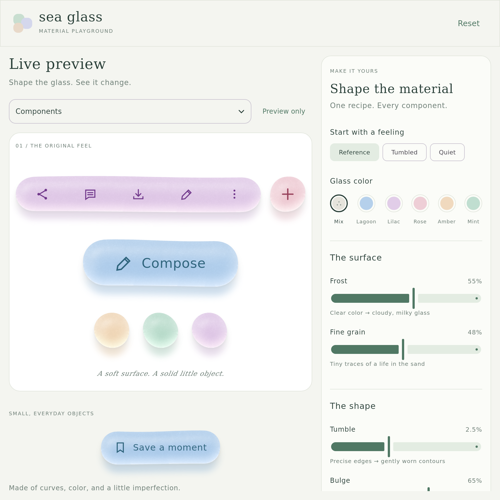
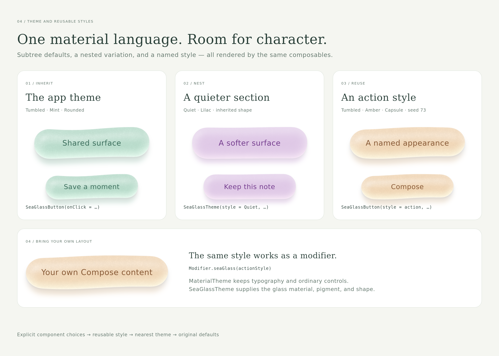
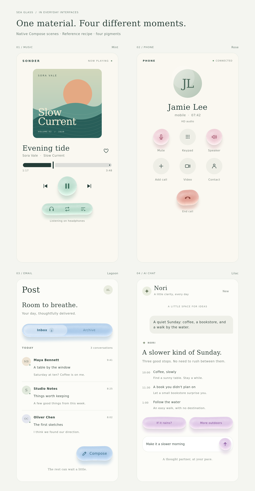

# Material rendering and parity

The visual source of truth is `web/dist/sea-glass.mjs`, copied from approved playground commit `7ce166bf9412b8be6ec48d4acf3d0e2e5fa01efa`. The web source is retained unchanged.

## Default live renderer

`LiveMaterialRenderer` is the default on Android 13+ and Skia. It draws the complete material during the first draw, using Android `RuntimeShader` or Skia `RuntimeEffect` for the body and native graphics-layer blur for the cast shadow, contact shadow and transmitted light. A hardware-accelerated window can execute these through its GPU backend; the headless JVM checks use software Skia and are not GPU performance measurements.

The renderer retains the tumbled vector contour and a small smooth geometry field. Geometry is rebuilt only for changes to component size, density, shape, tumble or seed. Lighting, pigment and other optical controls become shader uniforms. Relevant ground layers are re-recorded when their parameters change; the shadow direction stays fixed downward. There is no background bitmap job, initial flat fill or later material-image swap on the live path.

Only smooth shape information is sampled, at up to one sample per dp and reduced toward a 262,144-sample budget for oversized surfaces. The shader evaluates microscopic grain at display resolution, independent of that geometry sampling. Its procedural grain uses a different pattern from the original CPU implementation. The vector silhouette also renders at display resolution.

Android 7–12L automatically uses a CPU compatibility renderer. It runs off the main thread, keeps one active request plus the latest pending request, and approximates ground blur with four running-sum box filters. An initial flat fill or the previous completed image remains visible while rendering. The exact Gaussian CPU implementation remains available internally as the reference and benchmark oracle; it is not the modern platform's default renderer.

## Shared material model

1. Mulberry32 creates a stable sequence with JavaScript-compatible 32-bit overflow and unsigned shifts.
2. A seeded contour is smoothed and fitted to the component bounds. A periodic cubic B-spline gives continuous position, tangent, and curvature through the closing seam.
3. A rasterized silhouette feeds the same Euclidean distance transform and curved height field. The silhouette remains crisp while the interior crest is smoothed before differentiation.
4. Microscopic noise stays in material coordinates. Surface normals and pigment absorption create a denser middle, broad upper reflection, and tinted lower light exit. The live shader evaluates these per fragment rather than caching a complete shaded bitmap.
5. Fixed downward cast/contact layers and a colored transmitted-light pool are composited under the body. A grazing catch follows the lower geometric normals. Grain perturbs surface reflections without destabilizing that catch.

The reference CPU kernel uses `Double` calculations with the original `Float32` array boundaries preserved as Kotlin `FloatArray` fields. Its geometry, random sequences, noise and body shading are compared with fixtures generated from the JavaScript implementation. The live path retains the form and optical behavior using interpolated shape fields, shader arithmetic and new procedural grain.

## Exactness and platform differences


The checked-in comparison above was captured with the **exact CPU reference path**, including the Compose/Skia mask, bitmap upload and Canvas drawing. Its complete JVM comparison differs by at most 3/255 per channel, with an RMS difference of 0.72 over non-white channels. With a shared silhouette mask, the twelve reference body-shading fixtures are byte-identical to the JavaScript oracle; complete ground-and-body fixtures have RMS differences below 0.28/255. The CPU hill climb preserves all 336 measured pixel checksums. **None of these exactness claims apply to the default live shader.**

The live body is compared separately against the CPU reference over white at 2× density. Across the four current fixtures, its mean absolute RGB error is approximately **0.68–2.00 levels out of 255**. The grain positions differ, so this is a mean difference, not a maximum pixel bound:

| Fixture | Mean absolute difference | P95 difference | Maximum difference |
| --- | ---: | ---: | ---: |
| Lagoon rounded | 1.38/255 | 4/255 | 14/255 |
| Mint disc | 1.18/255 | 4/255 | 16/255 |
| Lilac capsule | 2.00/255 | 6/255 | 18/255 |
| Amber portrait | 0.68/255 | 2/255 | 4/255 |

These measurements cover the body, not the full component and native ground layers. Native blur, rasterization, numeric texture precision and display density can introduce additional platform differences. The fallback's four-box blur is also measured separately: the twelve ground cases remain below 0.18/255 RMS and 1.21/255 maximum channel difference over white relative to exact Gaussian ground.

The palettes, stable piece identity, downward light exit and ground-layer order remain consistent. Pixels are not universally identical across browser Canvas, Android Canvas and Skia. The compatibility renderer retains the original 2× material sampling cap and one-megapixel budget; the live shader's final body, grain and silhouette render at display resolution. Native text and icons are independent of either material path.

## Reproduce checks

```sh
cd tools
npm ci
npm run generate-reference
cd ..
./gradlew -PseaGlass.android=false :sea-glass:jvmTest
cd web
npm test
```

The oracle appends a temporary debug export to an in-memory copy of the JavaScript module; it does not alter the approved source. Fixtures include a source hash, random/contour samples, masks, intermediate fields, shaded pixels and complete images. Tests inject the recorded mask to distinguish CPU numerical parity from platform rasterization. Complete reference renders exercise the Compose mask rasterizer and pixel upload separately.

Shader tests compile the actual native program, validate its numeric texture inputs and compare its body output against the reference. `LiveMaterialBodyTest` writes reference/live images and metrics into `sea-glass/build/reports/sea-glass-live/`. All 28 tests pass with no failures or skips; the playground's three interaction checks and Android `demoRelease` build, R8 optimization and vital lint also pass. iOS targets and a sample view controller are included, but an Xcode build and device screenshot comparison have not been run. JVM image checks do not establish Android/iOS pixel identity or device performance.

Pinned version references: [Compose compatibility](https://kotlinlang.org/docs/multiplatform/compose-compatibility-and-versioning.html), [KMP Android library plugin](https://developer.android.com/kotlin/multiplatform/plugin), and [Compose graphics](https://developer.android.com/develop/ui/compose/graphics/draw/overview).

## Native Compose screenshots

These images capture the actual Compose hierarchy with the desktop Skia renderer at 2× density, including native text and icons. They are not HTML recreations or Android emulator captures. The narrow capture shows the same responsive shared playground at a phone-like width. The tablet and four-app-interface images below have been regenerated with the final live shader; the remaining galleries retain their earlier CPU captures until regenerated. The capture's settling wait is retained for layout and interaction state, though the live material itself draws completely on its first draw.


[Narrow playground layout](screenshots/playground-narrow.png)



The shared playground switches to two panes at 600 dp of available width. The preview stays visible while scrolling the controls; settings survive resizing and Android activity recreation. These captures exercise [700 dp unfolded windows](screenshots/playground-foldable.png), [the 600 dp split-window boundary](screenshots/playground-split.png), and [a compact 420 dp window](screenshots/playground-compact.png).






These interactive mock interfaces use ordinary Compose layouts with sea glass reserved for playback controls, call controls, the inbox toolbar and compose action, and chat suggestions/send. Select them in the playground's scene dropdown; the active material recipe applies to their accents. `SeaGlassShowcase(scene)` also renders any example without playground chrome for native galleries and screenshots.

Recreate all eleven images with JDK 17:

```sh
./gradlew -PseaGlass.android=false :desktopApp:captureScreenshots
```

The capture entry point and galleries are in `desktopApp/src/main/kotlin/dev/mttmcknn/seaglass/desktop/`. Output is written to `docs/screenshots/`. The public recipe/component APIs used by these galleries are the same APIs used by the app.

`./gradlew -PseaGlass.android=false :desktopApp:verifyPlayground` checks the actual Compose hierarchy: controls scroll without moving or changing the visible preview, the Tumble slider redraws the material, and resizing through 600 → 599 → 700 dp preserves the selected value. This is headless Compose verification, not an Android device performance measurement.
