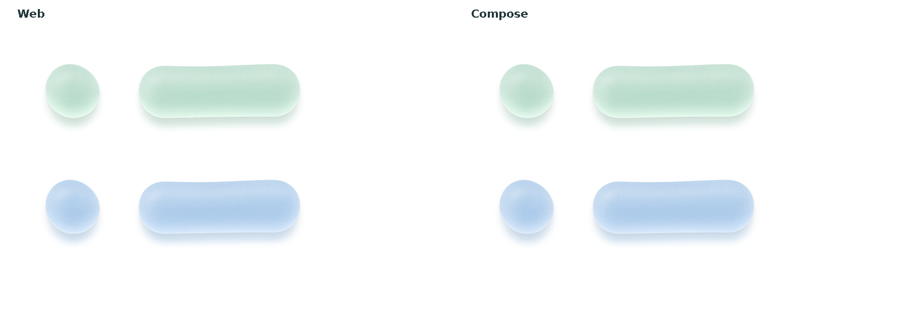
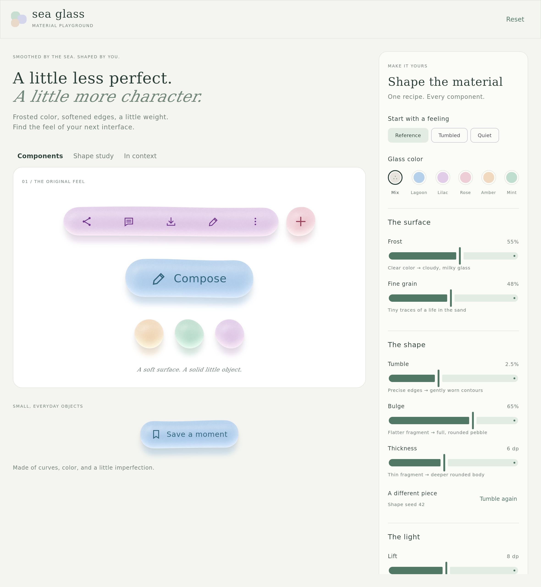
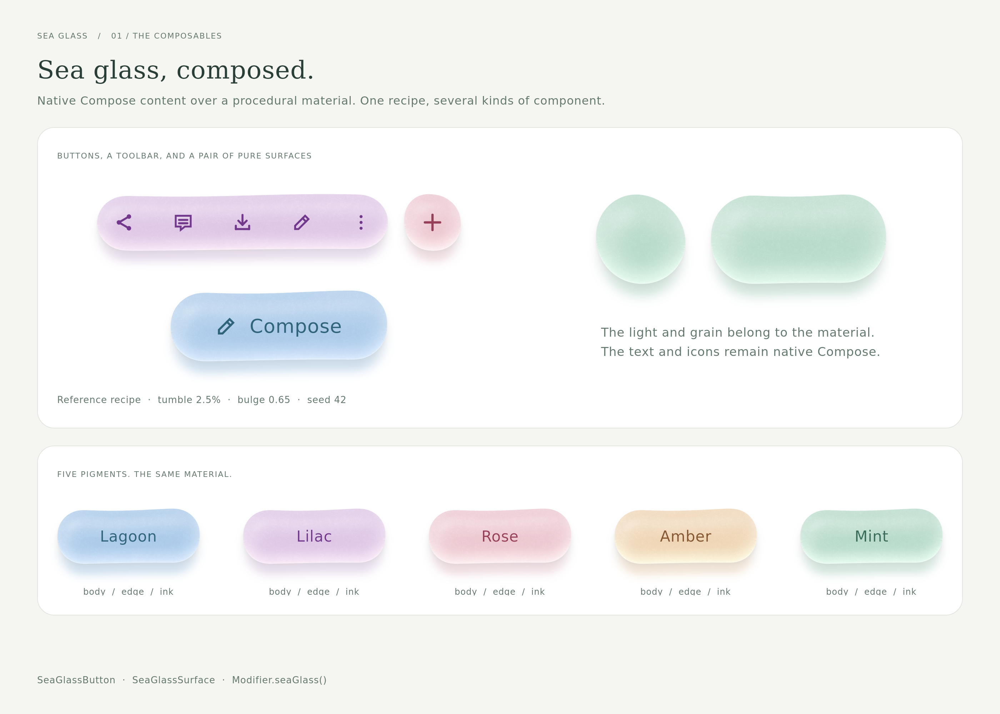
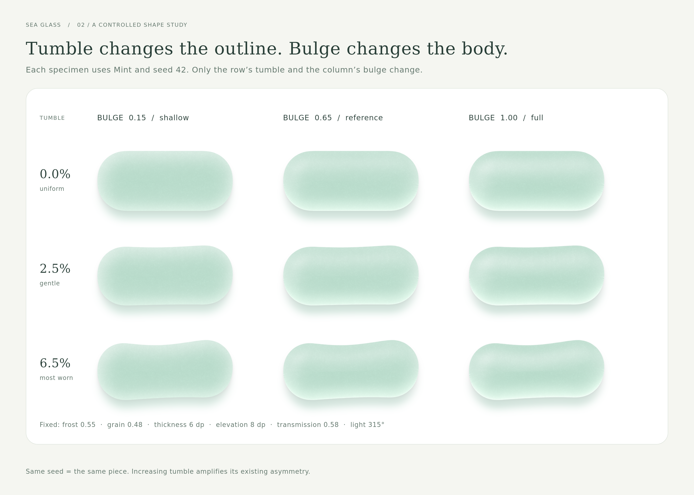
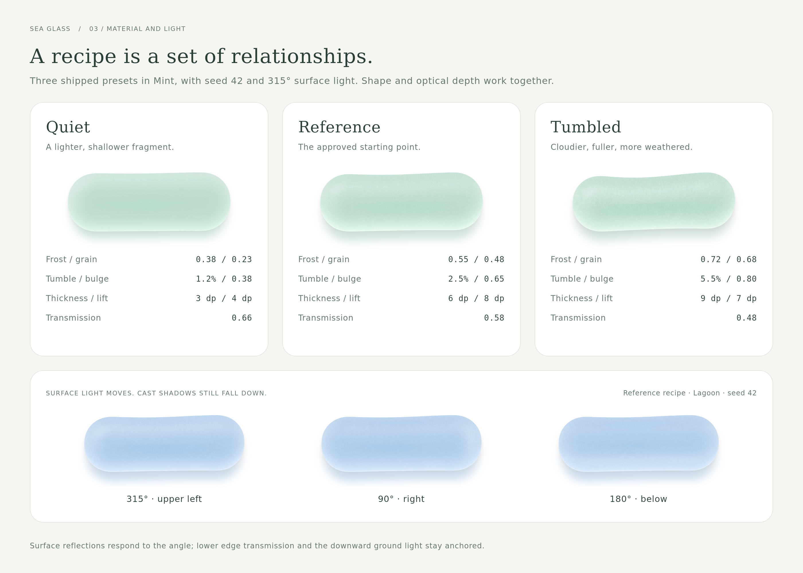

# Material rendering and parity

The visual source of truth is `web/dist/sea-glass.mjs`, copied from approved playground commit `7ce166bf9412b8be6ec48d4acf3d0e2e5fa01efa`. The web source is retained unchanged.

## Shared model

1. Mulberry32 creates a stable sequence with JavaScript-compatible 32-bit overflow and unsigned shifts.
2. A seeded contour is smoothed and fitted to the component bounds. A periodic cubic B-spline gives continuous position, tangent, and curvature through the closing seam.
3. A rasterized silhouette feeds the same Euclidean distance transform and curved height field. The silhouette remains crisp while the interior crest is smoothed before differentiation.
4. Correlated microscopic noise stays in material coordinates. Cached normals and pigment absorption create a denser middle, broad upper reflection, and tinted lower light exit.
5. Fixed downward cast/contact layers and a colored transmitted-light pool are composited under the body. A grazing catch follows the lower geometric normals. Grain perturbs surface reflections without destabilizing that catch.

The Kotlin kernel uses `Double` calculations with the original `Float32` array boundaries preserved as Kotlin `FloatArray` fields. Geometry, random sequences, noise, and body shading are compared with fixtures generated from the JavaScript implementation.

## Exactness and platform differences



The checked-in comparison uses the production Compose/Skia path mask, bitmap upload, and Canvas drawing. On the validated JVM build, the complete comparison differs by at most 3/255 per channel, with an RMS difference of 0.72 over non-white channels. With a shared silhouette mask, the twelve body-shading fixtures are byte-identical to the JavaScript oracle; complete ground-and-body fixtures have RMS differences below 0.28/255.

The material equations, defaults, palettes, seeded identity, and layer order are ported directly. Cross-platform pixels are not universally bit-identical: path antialiasing can differ among browser Canvas, Android Canvas, and Skia; browser blur kernels are implementation-dependent. The Kotlin ground renderer uses a normalized separable Gaussian and fractional mask translation. These differences are isolated from the color/lighting kernel and measured separately.

Material sampling is capped at 2x on both implementations. The web canvas can draw its final shadows at up to 2.5x while the native port uses its 2x cached material before scaling to display density. This can produce minor edge differences at higher densities. Native text and icons are independent of this cap.

## Reproduce checks

```sh
cd tools
npm ci
npm run generate-reference
cd ..
./gradlew -PseaGlass.android=false :sea-glass:jvmTest
cd web
npm test
```

The oracle appends a temporary debug export to an in-memory copy of the JavaScript module; it does not alter the approved source. Fixtures include a source hash, random/contour samples, masks, intermediate fields, shaded pixels, and complete images. Tests inject the recorded mask to distinguish numerical parity from platform rasterization. Complete native renders exercise the Compose mask rasterizer and pixel upload separately.

Android library and sample builds are verified, including AAR and debug APK packaging. iOS targets and a sample view controller are included, but an Xcode build and device screenshot comparison have not been run. JVM image parity does not establish Android/iOS pixel identity or device performance.

Pinned version references: [Compose compatibility](https://kotlinlang.org/docs/multiplatform/compose-compatibility-and-versioning.html), [KMP Android library plugin](https://developer.android.com/kotlin/multiplatform/plugin), and [Compose graphics](https://developer.android.com/develop/ui/compose/graphics/draw/overview).

## Native Compose screenshots

These images capture the actual Compose hierarchy with the desktop Skia renderer at 2x density, including native text and icons. They are not HTML recreations or Android emulator captures. The narrow capture shows the same responsive shared playground at a phone-like width. Capture waits for asynchronous material jobs to settle before writing an image.



[Narrow playground layout](screenshots/playground-narrow.png)







Recreate all five images with JDK 17:

```sh
./gradlew -PseaGlass.android=false :desktopApp:captureScreenshots
```

The capture entry point and galleries are in `desktopApp/src/main/kotlin/dev/mttmcknn/seaglass/desktop/`. Output is written to `docs/screenshots/`. The public recipe/component APIs used by these galleries are the same APIs used by the app.
